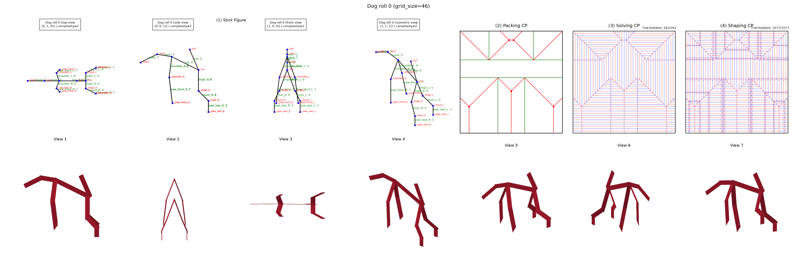

# Pleatwright

[](https://www.youtube.com/watch?v=8e9vlsNsiY0)

Pleatwright is AI-native CAD software for origami design. You type a subject
("a dog"), and it designs a model that folds from **one uncut square sheet**:
no cuts, no glue, no second sheet. It outputs crease patterns that a person
can fold and a simulated folded model.

The system is neuro-symbolic. A language model handles the one step that needs
judgment: reading a 3-D shape and deciding which flaps the model needs and how
long each one is. Deterministic computational-origami algorithms do the rest:
packing, crease assignment, flat-foldability checks and shaping. A SAT solver
certifies that the result folds. The LLM never draws a crease.



*`examples/dog_0_46/`: one of the 51 committed stick-figure trees, folded on a
46×46 grid. All 262 solving creases are flat-foldable, and the global layer order
is SAT-certified. Folding it takes about 10 s on a laptop.*

## How it works

```
text prompt
  → concept image        Nano Banana 2.1 (or FLUX.1-schnell)
  → 3-D mesh             Hunyuan3D-2
  → stick-figure tree    a vision-language model reads rendered views of the mesh
                         and calls a `submit_tree` tool; a schema contract rejects
                         malformed trees; a human approves or gives feedback
  → box-pleated base     flaps packed into an N×N grid that tiles the whole square,
                         with left/right leaf pairs mirrored about the centre line
  → solved CP            mountain/valley assignment, checked for local flat-foldability,
                         with a SAT-certified global layer order
  → shaped CP            narrowing and reverse folds at the tree's joints
  → folded model         a rigid fold simulation of the shaped crease pattern
```

Each model is written to a folder with four files, in the layout of COrigami's
released samples: `packing_cp.svg`, `solving_cp.svg`, `shaping_cp.svg` and
`overview.png`. Red creases are mountain folds, blue are valley folds, and green
are hinges.

**The LLM edits only the tree.** The tree is a small JSON object
(`nodes: [{name, parent, length, direction}]`, `pairs`, `readings`), so it is easy
to validate, diff and review. A malformed or unfoldable tree fails a checker,
which returns a specific error, instead of becoming a broken crease pattern.

## Measured results

These figures come from the evidence folders under `docs/superpowers/evidence/`:

* **Tree authoring:** Claude Haiku authored trees for all 17 original subject
  meshes, three rolls each, and **51/51 folded**, at about $0.003 per tree.
* **Concept image:** Nano Banana 2.1 concept images gave meshes with correct anatomy
  on **33/34** owner-scored subjects, against 21/34 for FLUX.1-schnell
  (`2026-10-16-concept-image/`).
* **Whole-square tiling:** the base builder refuses to emit a base that leaves any
  grid cell uncovered. Every model uses the entire sheet.

## Running it

Requirements: Python 3.14. Node 22 is needed only for the web app.

```bash
python3.14 -m venv mcp_harness/.venv
mcp_harness/.venv/bin/pip install -r requirements.txt
make test                       # full suite: pipeline, then app server (about 20 min)
```

Fold one of the committed trees. This needs no API key and no network:

```bash
cd mcp_harness
.venv/bin/python -m pleatwright fold dog_0 --out /tmp/pw    # writes /tmp/pw/<Subject>_<grid>/
```

The full text-to-model run needs API keys. Copy `.env.example` to `.env` and fill
in `ANTHROPIC_API_KEY`, plus `HF_TOKEN` and optionally `GEMINI_API_KEY` for the
mesh stage:

```bash
.venv/bin/python -m pleatwright run "a dog" --out /tmp/pw --open   # author, review, then fold
```

In the review loop, `a` approves the tree, `q` quits, and any other line is sent
to the model as revision feedback. `MESH_PROVIDER=fake` (the default) replaces the
mesh stage with 17 committed meshes, so you can work offline.

The local web app shows the conversation on one side, and the concept image,
mesh, tree, crease patterns and folded model on the other:

```bash
make app        # http://127.0.0.1:8000
```

## Repository layout

| path | what |
|---|---|
| `mcp_harness/pleatwright/` | tree → model: `stick`, `pack`, `nest`, `base`, `solve`, `narrow`, `shape`, `fold`, `cp`, `render`, `pipeline` |
| `mcp_harness/pleatwright/certify/` | flat-foldability and SAT layer-order certification |
| `mcp_harness/` (top level) | mesh acquisition, VLM tree authoring, tree contract, human review gate |
| `app/` | FastAPI server with an event log, and a React + three.js UI |
| `mcp_harness/fixtures/` | the 51 stick-figure trees the tests and examples use, and the 17 offline meshes (`meshes/`) |
| `docs/superpowers/` | design specs, implementation plans and measured evidence for each stage |
| `examples/` | a folded example (the image above) |

`CLAUDE.md` and `AGENTS.md` are the instructions given to the AI coding agents
that helped build this project. They are kept because they document the
development process. One rule in them: research prior art before writing any
plan.

## Credits

Pleatwright was inspired by, and closely follows, the pipeline in this paper from
Google DeepMind researchers and origami artists:

> Zahavy, T., Hou, S., Tumiel, T., Doran, J., Faccio, F., Feng, X., ... Singh, S.
> (2026). *COrigami: An AI Pipeline for Co-Designing Flat-Foldable Visually
> Recognisable Origami.* arXiv. https://arxiv.org/abs/2606.26299

Where Pleatwright deviates from COrigami is recorded in
`docs/superpowers/specs/2026-10-06-corigami-tree-to-model-pipeline.md`. The
tree method and box pleating build on Robert J. Lang's work, *Origami Design
Secrets*.
