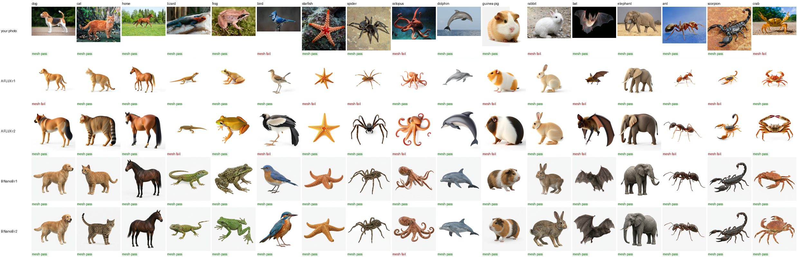
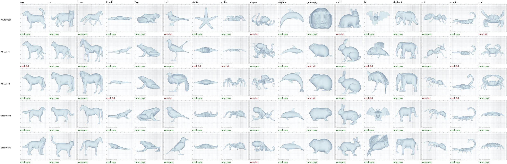

# Concept-image quality experiment: results (2026-10-16 to 2026-10-19)

Spec: `docs/superpowers/specs/2026-10-16-concept-image-quality-design.md`.
Plan: `docs/superpowers/plans/2026-10-16-concept-image-quality.md`.
Code: `mcp_harness/gemini_image.py`, `subject_rewrite.anatomy()`, `mcp_harness/concept_ab/`.
Raw cells (images, meshes, drafts, owner scores):
`~/Pleatwright/experiments/2026-10-16-concept-image/` (not in the repo).

## Verdict

**Nano Banana 2.1 with the shipped concept prompt (arm B) is the winner, and it
held on a second draw.**

| | round 1 | round 2 | both rounds |
|---|---|---|---|
| B: Nano Banana 2.1, shipped template | **17/17** | **16/17** | **33/34** |
| A: FLUX.1-schnell, shipped template (today) | 11/17 | 10/17 | 21/34 |

* B beats the owner's hand-picked photo meshes, which pass 13/17 on the owner's
  corrected marks.
* B clears the spec's good-enough bar (photo bar minus 1 = 12) in both rounds.
  FLUX does not.

Neither anatomy text (arm C) nor a photographic prompt (arm D) improved on B.
Arm E (best of 4 plus a Claude picker) was **not run**: a single Nano Banana
image is already good enough, which was the spec's condition for skipping it.

## Arms and tallies

A mesh passes when every checklist part is present, attached and correctly
numbered, with no extra limbs or tails, no base, and no large detached piece.
Small floating specks and slivers do not fail a mesh (owner rule, 2026-10-18).
The owner's reading is final. Hunyuan3D-2 used the identical settings in every
cell (`HUNYUAN_SHAPE_KWARGS`, seed 1234; pinned by
`test_default_provider_is_the_fixed_lift`).

| arm | image model | prompt | r1 | r2 |
|---|---|---|---|---|
| photo | owner's library photos | — | 13/17 (corrected in r2; 15 as first marked) | — |
| A | FLUX.1-schnell, 4 steps | shipped `CONCEPT_PROMPT_TEMPLATE` | 11 | 10 |
| B | `gemini-nano-banana-2.1` | shipped template | **17** | **16** |
| C | Nano Banana 2.1 | shipped template + Claude anatomy text | 16 | — |
| D | Nano Banana 2.1 | wildlife-photograph template + anatomy text | 15 | — |

Mesh pass/fail per subject (P/F):

| subject | photo | A r1 | A r2 | B r1 | B r2 | C r1 | D r1 |
|---|---|---|---|---|---|---|---|
| dog | P | F | P | P | P | P | P |
| cat | P | P | P | P | P | P | P |
| horse | P | P | P | P | P | P | P |
| lizard | P | P | F | P | P | P | P |
| frog | P | P | P | P | P | P | P |
| bird | F | P | F | P | P | P | F |
| starfish | P | F | P | P | P | P | P |
| spider | P | F | P | P | P | F | P |
| octopus | F | P | F | P | F | P | P |
| dolphin | P | P | P | P | P | P | P |
| guinea pig | P | F | F | P | P | P | P |
| rabbit | F | P | P | P | P | P | P |
| bat | P | F | F | P | P | P | P |
| elephant | P | P | P | P | P | P | P |
| ant | P | P | F | P | P | P | P |
| scorpion | P | F | F | P | P | P | P |
| crab | F | P | P | P | P | P | F |

## Why each mesh failed

From the drafts the owner confirmed, plus the owner's own notes.

* **FLUX (A): wrong anatomy in the image itself.**
  * bat r1: an extra pair of legs.
  * starfish r1: 6 arms.
  * spider r1: 7 legs.
  * lizard r2: a fifth limb under the head, and "head too small in image" (owner).
  * guinea pig r1 and r2: a rat-like tail.
  * scorpion r2: an extra leg stub on one side (owner).
* **FLUX (A): parts that come apart in the lift.**
  * scorpion r1: the tail floats free of the body.
  * dog r1: legs detached.
  * bird r2: a lower leg floats below its stub.
  * ant r2: a leg segment floats beside the gaster.
  * octopus r2: an arm tip floats free.
  * bat r2: no tail.
* **B r2 octopus:** the only failure in 34 B cells. An arm is detached.
* **C spider:** a leg-like segment floats below the body.
* **D:**
  * crab: 5 legs a side.
  * bird: lifted with its perch. The photographic prompt draws the animal in a
    scene, despite "plain uncluttered background".
* **Photo row:**
  * bird: the perch was lifted with the bird.
  * crab: a detached leg segment.
  * octopus: 9 arms (owner).
  * rabbit: feet cut off or blobbed (owner).

**Mechanism.** FLUX's failures start in the picture: miscounted limbs, an
invented tail, or a tail drawn barely touching the body. Hunyuan lifts these
faithfully. Nano Banana draws the right anatomy, large in the frame and on a
plain background, and Hunyuan keeps it.

## Findings that change earlier beliefs

1. **The gap was the image, not the lift.** The library meshes used
   Hunyuan3D-2 with exactly the live settings.
2. **Photo style is not the lever.** Arm D was no better than B and pulled the
   animal into scenes. Prior art agrees: Hunyuan3D-2's own text-to-image
   helper asks for "3D style". The owner's photos won on correct anatomy and
   pose, not on photographic look.
3. **Anatomy text did not help** once the image model was strong enough
   (C 16 vs B 17). Shipping B needs no extra Claude call.
4. **A Claude Sonnet 5 judge cannot be trusted on detachment.** It passed the
   floating scorpion tail. Opus 5.5 and Fable 5.1 caught it.
   * Even Opus drafts missed 3 owner mesh fails in round 2: photo octopus 9
     arms, photo rabbit feet, and the A r2 scorpion leg stub.
   * In round 1 the owner changed none of the 170 draft marks. In round 2 the
     owner changed 5 of 102.
   * Drafts save review time but are not a substitute for the owner's look.
5. **Picker calibration** (Opus, anatomy text only, against the owner's image
   labels, round 1): 55/68 agree, 13 false rejects, 0 false accepts.
   * The round-1 labels equal the Opus checklist drafts, so this is
     judge-to-judge agreement.
   * The picker is conservative, which is the safe direction for picking.
6. **Every round-1 mesh still authors a tree that folds** (85/85, one Claude
   authoring run each).
   * Leaf counts matching the artifact trees: photo 12, A 10, B 11, C 8, D 9.
   * This is a weak, single-run signal; it was not run for round 2.

## Nano Banana 2.1 facts (live probe)

* Paid tier only: the free tier's image quota is 0.
* About 12 s per image; JPEG, 1024×1024.
* `seed` is accepted but **not reproducible**: the same seed gives a
  different image.
* About **$0.042 per image** = 1,120 image tokens at $30/M, plus about 1,100
  text and thinking tokens at $7.50/M.

## Cost

* Gemini: 70 images (2 probe + 51 round 1 + 17 round 2) = **$2.94** on the
  ledger. The cap was $15.
* Hunyuan: 102 lifts on the free ZeroGPU quota, with no quota stops.
* Claude (anatomy text, roughly 400 Opus judge calls, 85 tree authorings): not
  metered by the ledger. Estimated at a few dollars.

## Next (Phase 2, spec §4: its own short design)

Make B the `hf2` image stage:

* a Gemini backend in `TwoStageProvider` using `gemini_image.generate_image`
  with the shipped template;
* FLUX kept as the fallback when `GEMINI_API_KEY` is absent;
* the image model added to the cache key;
* the mesh-review redraw path kept working. Seeds no longer reproduce, so a
  redraw is simply a fresh draw.
